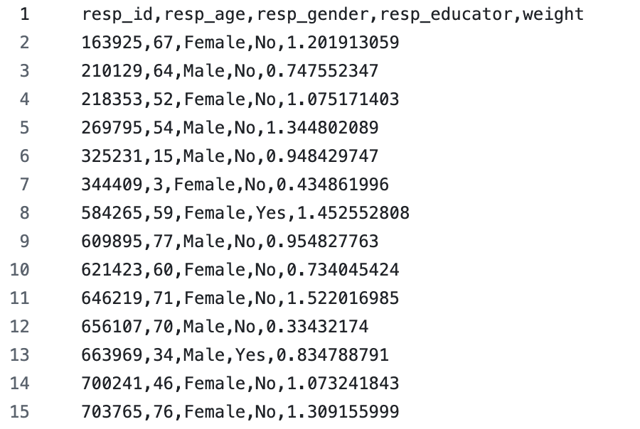

# Estimating age-specific contact matrices 
In this tutorial, we will explore how to estimate age-specific contact matrices using contact patterns data. Contact matrices can then be plotted, as described in [Tutorial 3](../data-analysis/3_Visualizing_contact_matrices.md). These contact matrices can then be used as an input in models that simulate epidemics, as described in [Tutorial 4](../mathematical-modeling/4_Compartmental_modeling_with_contact_matrices.md).  

## Requirements
This tutorial is presented with code examples in [R](https://www.r-project.org/), but the sequence of steps would be similar in other languages like [python](https://www.python.org/). In any case, it assumes some familiarity with programming languages. 

In the code examples, we directly use the following R packages: 
- [`dplyr`](https://cran.r-project.org/web/packages/dplyr/) for efficient operations with dataframes.
- [`tidyr`](https://cran.r-project.org/web/packages/tidyr/) for converting between long and wide dataframes.
- [`mgcv`](https://cran.r-project.org/web/packages/mgcv/) for working with generalized additive models.

The code was tested in Rstudio version 4.5.1. In a `.r` R code file, you can install these packages and load the libraries using:
```R
lapply(c("dplyr", "mgcv", "ggplot2", "tidyr"), function(x){
  if(!require(x, character.only = T)){
    install.packages(x)
  }
  library(x, character.only = T)
})
```
## Loading the necessary data
To estimate age-specific contact matrices, we need at least two data elements: respondent-level contact patterns data and contact-level contact patterns data.

In this tutorial, we will import our data from `.csv` files stored in the working directory of the R code. The respondent-level contact patterns data should be formatted as follows:



and can be loaded by: 
```R
resp_imp = read.csv("imputed_resp.csv")
```

The contact-level patterns data should be formatted as: 


and can be loaded into the program by:
```R
cont_imp = read.csv("imputed_cont.csv")
```
Codebooks describing the variables of both contact patterns datasets are available [here](.../data/imputed_data).


## Estimating age-specific contact matrices 
### Preparing the dataset for analysis
Before we can create the contact matrices, we need to combine the respondent- and contact-level data into a single dataset, and we do this using a `left_join` function from the `dplyr` package. 
```R
merged.df = left_join(resp_imp, cont_imp, by = "resp_id")
```

Then, we create a new binary variable that indicates whether or not a respondent reported contacts, where `0` = no  and `1` = yes.
```R
### substitute this code (should start with the definition of "settings = ...")
cont_cols = grep("^cont_", colnames(merged.df), value = TRUE)
nocont = rowSums(!is.na(merged.df[, cont_cols])) == 0
merged.df$binary_col = ifelse(nocont, 0, 1)
```

### Estimating the number of contacts between single-year respondent-contact age groups
To ensure that the contact matrices are representative of the target population (the US in this case), we must weight the number of participants by age. Here, we do this by using the original responde-level dataset and a `group-by` to group all respondents belonging to a given age group and sum their weights to obtain the number of respondents of a given age. 
```R
age_matrix_n = merged.df %>%
  group_by(resp_age, resp_id) %>%
  summarise(weight = mean(weight, na.rm = TRUE)) %>%
  group_by(resp_age) %>%
  summarise(n = sum(weight, na.rm = TRUE))
```

Then, we used `expand.grid` to create a dataframe containing the combination of contact and respondent ages to include in our matrix: 
```R
nd = expand.grid(resp_age = c(0:max(merged.df$resp_age)),
                 cont_age = c(0:max(merged.df$resp_age)))

predict.m = as.data.frame(nd)
```
Then, we estimate the weighted sum of contacts by the respondent-contact age group. (Example: the weighted sum of contacts between respondents ages 0-4 years old with contacts ages 0-4 years old). Here, we assume that `NA` is equivalent to a weighted sum of 0. Then, we divide the weighted sum of contacts by the weighted number of respondents stored in `age_matrix_n` to obtain the average number of contacts by respondent-contact age group.  
```R

# obtain the weighted sum of contacts per respondent-contact group
  age_matrix_s = merged.df %>%
    filter(!is.na(!!sym("cont_age"))) %>%
    arrange(!!sym("cont_age")) %>%
    group_by(!!sym("cont_age"), !!sym("resp_age")) %>%
    summarise(weighted_sum = sum(weight*!!sym(setting_names), na.rm = T))
  
  # combine weighted sum with the data for predictions
  age_matrix_s = left_join(predict.m, age_matrix_s)
  
  # change NAs
  age_matrix_s$weighted_sum[is.na(age_matrix_s$weighted_sum)] = 0
  
  # combine total weighted contact sum with weighted N of people
  age_matrix_s = left_join(age_matrix_s, age_matrix_n)
  
  # order
  age_matrix_s = age_matrix_s[order(age_matrix_s[,"resp_age"], age_matrix_s[,"cont_age"]),]
  
  # average number of contacts for the matrix
  age_matrix_s$ncont = age_matrix_s$weighted_sum/age_matrix_s$n
  
```
### Using generalized additive models to predict contacts
Once we have the average number of contacts, we fit a generalized additive model (GAM) with a log link to the data where the average number of contacts is the dependent variable and the respodents age and the contacts age are the independent variables. We do this using the `gam ` function from the library `mgc`. Using a GAM allows us to capture non-linear realtionships between the respondent-contact age groups and the number of contacts they have. In the GAM, we also consider different smoothing procedures based on the setting of the contact, which were implemented using the function `te`. For contacts in workplaces, we use a thin plate regression spline which allows more flexibility in modeling complex non-linear relationships, such as those with workplace contacts. For contacts in other settings, we use a cyclic cubic smoothing spline as this method assumes the contacts to be continous and smooth across age groups. 
The GAM for contacts in the workplace is formulated as:

To continue with estimating contacts in the household, the GAM is formulated as: 
```R
model = gam(ncont ~ te(as.numeric(resp_age), as.numeric(cont_age),
                        k = c(10,10), bs = c("cc","cc"), m = c(0,0)),
                family = nb(),
                data = age_matrix_s)
```
That model would also be used for estimating contacts in schools and other settings. To estimate contacts in the workplace, the GAM would need to be formulated as: 
```R
model = gam(ncont ~ te(as.numeric(resp_age), as.numeric(cont_age),
                        k = c(4,4), bs = c("tp","tp"), m = c(0,0)),
                family = nb(),
                data = age_matrix_s)
```

Then, we predict the number of contacts by respondent-contact age group
```R
 age_matrix_s$pred = predict(model, newdata = age_matrix_s, type = "response")
```

### Estimating the number of contacts between 5-year respondent-contact age groups
Many times, you will opt for creating contact matrices using age groups rather than single-year ages. For the remainder of this tutorial, we will create the age-specific household contact matrix using 5-year age groups. 

To do this, we need to specify the age groups for the respondents. The code shown below is repeated for contact age groups and for the respondent age groups in the respondent-only data. 
```R
age.breaks = list("_by5_80" = c(seq(0,80, by = 5), 120))
age.vars.names = c("_by5_80")

tmp.vars = lapply(age.breaks, function(x) {
  maxv = x[length(x)]
  if (maxv > max(merged.df[,"resp_age"], na.rm = TRUE)) {
    mylabels = c(
      paste(x[1:(length(x)-2)], x[2:(length(x)-1)] - 1, sep = "-"),
      paste0(x[length(x)-1], "+")
    )
  } else {
    mylabels = paste(
      x[1:(length(x)-1)],
      x[2:length(x)] - 1,
      sep = "-"
    )
  }
  
  cut(
    merged.df[,"resp_age"],
    breaks = x,
    labels = mylabels,
    right = FALSE
  )
})
tmp.names = paste0("resp_age", age.vars.names)
names(tmp.vars) = tmp.names
merged.df[,tmp.names] = as.data.frame(tmp.vars)
```
Respondent specific weights, weighted sum of contacts between respondent-contact age groups, and estimating the average number of contacts between groups follows the same procedures shown previously. For this example, we will reference these average contacts by age groups as `matrix_age`. It is important to note that for the 5-year age-specific contact matrices, we do not use a GAM to predict contacts as we do not need to smooth the estimates.  After `matrix_age` is obtained, we will use the `pivot_wider` function to convert this into a matrix by respondent-contact age groups. 
```R
 matrix_age = age_matrix %>% 
    select("resp_age_by5_80", "cont_age_by5_80", "ncont") %>% 
    pivot_wider(names_from = "cont_age_by5_80", values_from = "ncont")
```
The resulting 5-year age-specific contact matrix is what will be used in [Tutorial 3](../data-analysis/3_Visualizing_contact_matrices.md) to visualize contact matrices and in [Tutorial 4](../mathematical-modeling/4_Compartmental_modeling_with_contact_matrices.md) to show how contact matrices can be used in compartmental models. 

### Full code
You can check out the full code for this tutorial here: [constructing_contact_matrices.R](./code/constructing_contact_matrices.R)
