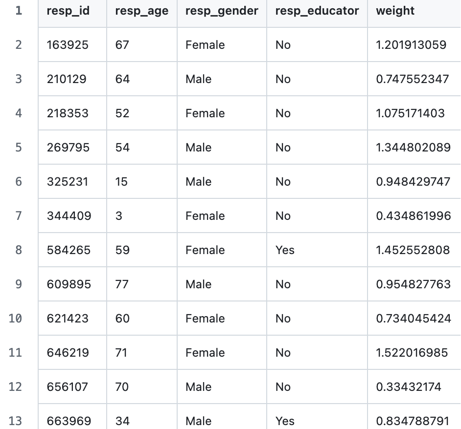
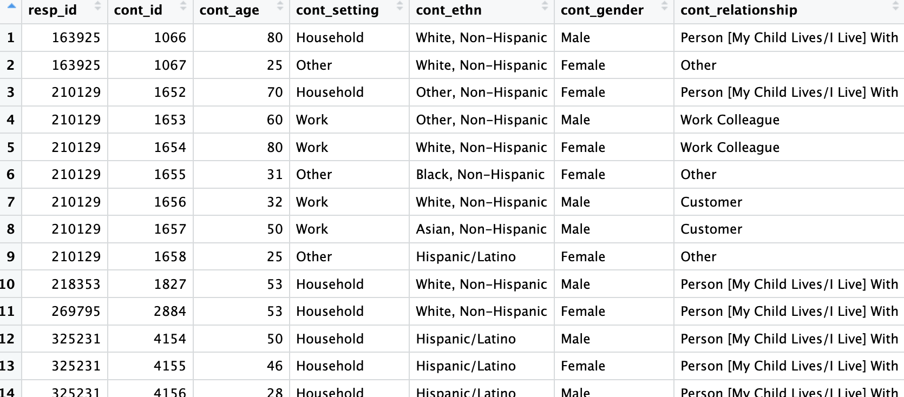

# Estimating age-specific contact matrices 
In this tutorial, we will explore how to estimate age-specific contact matrices using contact patterns data. Contact matrices can then be plotted, as described in [Tutorial 3](../data-analysis/3_Visualizing_contact_matrices.md) and used as an input in models that simulate epidemics, as described in [Tutorial 4](../mathematical-modeling/4_Compartmental_modeling_with_contact_matrices.md).  

This tutorial uses the data specifically created for these tutorials ([here](./tutorials/data_analysis/data)) and is intended as a learning resource. To reproduce the analysis on the full dataset, please use the code provided [here](.../code) and the data provided [here](.../data).

## Requirements
This tutorial is presented with code examples in [R](https://www.r-project.org/), but the sequence of steps would be similar in other languages like [python](https://www.python.org/). 
It assumes that both [R](https://www.r-project.org/) and [RStudio](https://posit.co/download/rstudio-desktop/) (or an alternative, like Jupiter Notebook) are installed.
It also assumes some familiarity with programming languages. 

In the code examples, we directly use the following R packages: 
- [`dplyr`](https://cran.r-project.org/web/packages/dplyr/) for efficient operations with dataframes.
- [`tidyr`](https://cran.r-project.org/web/packages/tidyr/) for converting between long and wide dataframes.
- [`mgcv`](https://cran.r-project.org/web/packages/mgcv/) for smoothing with generalized additive models (GAM).

The code was tested in RStudio version 4.5.1. In an R code file, you can install these packages and load the libraries using:
```r
lapply(c("dplyr", "mgcv", "ggplot2", "tidyr"), function(x){
  if(!require(x, character.only = T)){ ## checks if the packages have already been installed
    install.packages(x)
  }
  library(x, character.only = T)
})
```
## Loading the necessary data
To estimate age-specific contact matrices, we need at least two datasets: respondent-level contact patterns data and contact-level contact patterns data.

In this tutorial, we will import our data from `.csv` files stored in the working directory of the R code (see [Tutorial 1](../1_Accessing_and_extracting_data.md)):

```r
## read respondent-level data
resp_imp = read.csv("imputed_resp.csv")

## read contact-level data
cont_imp = read.csv("imputed_cont.csv")
```

The respondent-level contact patterns data are formatted as follows:



The contact-level patterns data are formatted as follows: 



Codebooks describing the variables of both contact patterns datasets are available [here](../../data/imputed_data).


## Estimating age-specific contact matrices 
### Preparing the dataset for analysis
Before we can create the contact matrices, we need to combine the respondent- and contact-level data into a single dataset. We do this using a `left_join` function from the `dplyr` package. 
```r
merged.df = left_join(resp_imp, cont_imp, by = "resp_id")
```

Then, we create a new binary variable that indicates whether or not a respondent reported contacts, where `0` = no  and `1` = yes.
```r
## create a vector of setting names
settings = unique(merged.df$cont_setting)

## create dummy variables for individual settings 
for(x in settings){
  merged.df[, paste("cont_", tolower(as.character(x)))] = ifelse(merged.df$cont_setting == x, 0, 1)
}
## save a vector of created dummies (or type the variable(s) that denote needed setting)
cont_cols = paste("cont_", tolower(as.character(settings)))

## create the binary variable to denote whether the respondent had non-zero contacts
nocont = rowSums(!is.na(merged.df[, cont_cols])) == 0
merged.df$binary_col = ifelse(nocont, 0, 1)
```

### Estimating single-year contact matrices (the number of contacts between single-year respondent-contact age groups)

First, to ensure that the contact matrices are representative of the target population (the US in this case) by age, we must account for the weight of each participant in the sample. Here, we do this by using the original respondent-level dataset and provided sample weights. We group all respondents belonging to a given age bracket (single year in this case) and sum their weights to obtain the number of people of a given age they represent (i.e., weighted number of respondents). 

```r
## calculate weighted number of respondents
age_matrix_n = resp_imp %>%
  group_by(resp_age) %>%
  summarise(n = sum(weight, na.rm = TRUE))
```

Then, we use `expand.grid` to create a dataframe containing all the combinations of possible contact and respondent ages to include in our matrix for smoothing.

```r
nd = expand.grid(resp_age = c(0:max(merged.df$resp_age)), # single-year brackets in this case
                 cont_age = c(0:max(merged.df$resp_age))) # single-year brackets in this case

predict.m = as.data.frame(nd)
```
Then, we estimate the weighted sum of contacts by the respondent-contact age group for a defined setting (Example: between respondents 4 years old with contacts 4 years old). 

```r
## Define the settings for matrix calculations ##
setting_names = c("binary_col") ## binary_col represents any contact, but a specific setting can be added (household, school, work, other) from "cont_cols"

# obtain the weighted sum of contacts per respondent-contact group
age_matrix_s = merged.df %>%
  filter(!is.na(cont_age)) %>%
  arrange(cont_age) %>%
  group_by(cont_age, resp_age) %>%
  summarise(weighted_sum = sum(weight*!!sym(setting_names), na.rm = T))

# combine weighted sum with the data for predictions
age_matrix_s = left_join(predict.m, age_matrix_s) # NAs will be created if the combination of contact and respondent ages/age groups does not exist in the data

# change NAs to 0s
age_matrix_s$weighted_sum[is.na(age_matrix_s$weighted_sum)] = 0 # Here, we assume that `NA` (or absence of the age group combination) is due to extremely low contact rates between these age groups.
```
Then, we divide the weighted sum of contacts by the weighted number of respondents stored in `age_matrix_n` to obtain the average number of contacts by respondent-contact age group.  
```R
# combine N of contacts with N of people
  age_matrix_s = left_join(age_matrix_s, age_matrix_n)
  
  # order the data frame
  age_matrix_s = age_matrix_s[order(age_matrix_s[,"resp_age"], age_matrix_s[,"cont_age"]),]
  
  # calculate average number of contacts for the matrix (total number of contacts)
  age_matrix_s$ncont = age_matrix_s$weighted_sum/age_matrix_s$n
  ```

### Using generalized additive models to create smoothed contact matrices
Once we have the average number of contacts, we can fit a generalized additive model (GAM), where the calculated average number of contacts depends on the respondent age/age group and the contact age/age group. We do this using the `gam ` function from the library `mgc`. Using a GAM allows us to capture potential non-linear relationships between age and the number of contacts.

```R
## Fit GAM model for total number of contacts (calculated above
model = gam(ncont ~ te(as.numeric(resp_age), as.numeric(cont_age),
                        k = c(10,10), bs = c("cc","cc"), m = c(0,0)), # k=10 degrees of freedom fits our data best
                family = nb(), # negative binomial is used as the number of contacts is distributed as a negative binomial in our data
                data = age_matrix_s)
```
In GAMs, one can use different smoothing procedures depending on the patterns observed in the data. For total contacts, we use a cyclic cubic (cc) smoothing spline, as it assumes a continuous base function (which is the case for single-year age brackets) and allows us sufficient flexibility to approximate different degrees of contact assortativity and heterogeneity. The benefits of cyclic cubic smoothing splines also include higher computational efficiency relative to other approaches. The number of degrees of freedom (k) should be [explored](https://cran.r-project.org/web/packages/santaR/vignettes/selecting-optimal-df.html) for each model specification, as it depends on the data used.

Then, we predict the number of contacts by respondent-contact age group using GAM model
```R
 age_matrix_s$pred = predict(model, newdata = age_matrix_s, type = "response")
```
These predictions allow us to visualize smoothed contact matrices (see [Tutorial 3](./3_Visualizing_contact_matrices.md)).

### Estimating the number of contacts between 5-year respondent-contact age groups
Many times, you will opt for creating contact matrices using age groups rather than single-year ages. For the remainder of this tutorial, we will create the age-specific contact matrix using 5-year age groups. 

To do this, we need to create the same age groups for respondents and contacts.

```R
age.breaks = list("_by5_80" = c(seq(0,80, by = 5), 120))
age.vars.names = c("_by5_80")

tmp.vars = lapply(age.breaks, function(x) {
  maxv = x[length(x)]
  if (maxv > max(merged.df[,"resp_age"], na.rm = TRUE)) {
    mylabels = c(
      paste(x[1:(length(x)-2)], x[2:(length(x)-1)] - 1, sep = "-"),
      paste0(x[length(x)-1], "+")
    )
  } else {
    mylabels = paste(
      x[1:(length(x)-1)],
      x[2:length(x)] - 1,
      sep = "-"
    )
  }
  
  cut(
    merged.df[,"resp_age"],
    breaks = x,
    labels = mylabels,
    right = FALSE
  )
})
tmp.names = paste0("resp_age", age.vars.names)
names(tmp.vars) = tmp.names
merged.df[,tmp.names] = as.data.frame(tmp.vars)
```
Respondent specific weights, weighted sum of contacts between respondent-contact age groups, and estimating the average number of contacts between groups follows the same procedures shown previously. For this example, we will reference these average contacts by age groups as `matrix_age`. It is important to note that for the 5-year age-specific contact matrices, we do not use a GAM to predict contacts as we do not need to smooth the estimates.  After `matrix_age` is obtained, we will use the `pivot_wider` function to convert this into a matrix by respondent-contact age groups. 
```R
 matrix_age = age_matrix %>% 
    select("resp_age_by5_80", "cont_age_by5_80", "ncont") %>% 
    pivot_wider(names_from = "cont_age_by5_80", values_from = "ncont")
```
The resulting 5-year age-specific contact matrix is what will be used in [Tutorial 3](../data-analysis/3_Visualizing_contact_matrices.md) to visualize contact matrices and in [Tutorial 4](../mathematical-modeling/4_Compartmental_modeling_with_contact_matrices.md) to show how contact matrices can be used in compartmental models. 

### Full code
You can check out the full code for this tutorial here: [constructing_contact_matrices.R](./code/constructing_contact_matrices.R)
